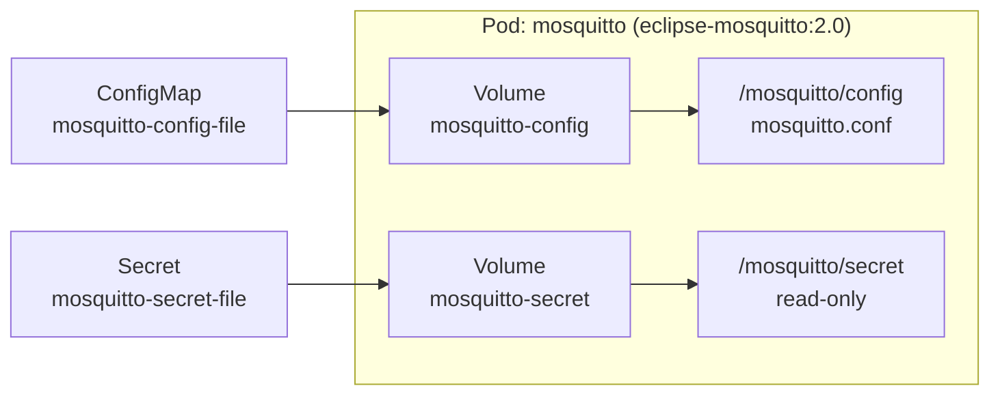
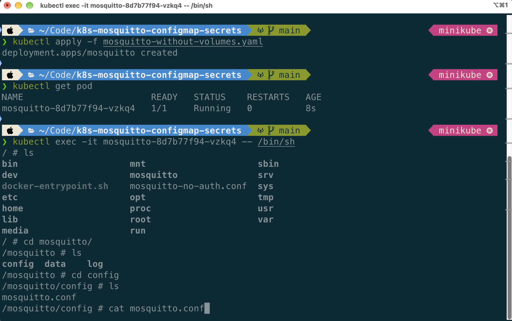
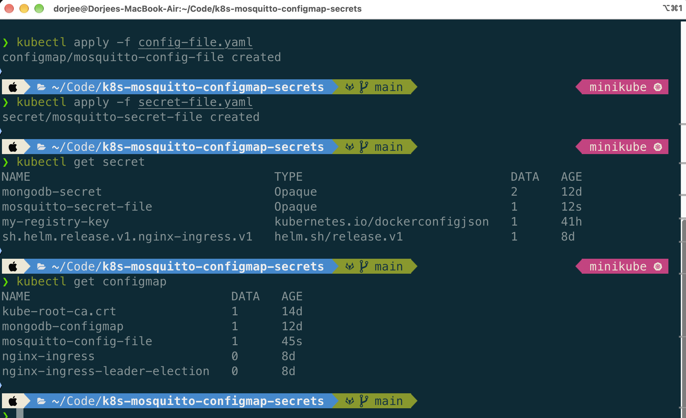
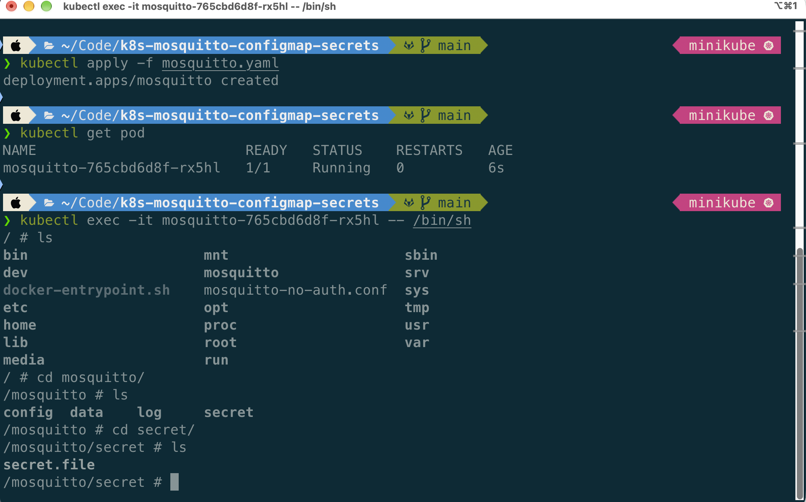
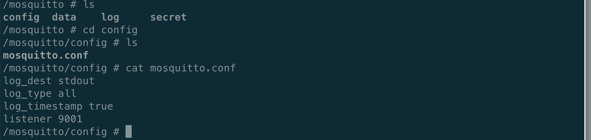

# k8s-mosquitto-configmap-secrets

Eclipse Mosquitto MQTT broker on Kubernetes, with its configuration and credentials supplied through **ConfigMap** and **Secret** volumes.


---

## Table of Contents

1. [Overview](#overview)
2. [Architecture](#architecture)
3. [Concepts](#concepts)
4. [Prerequisites](#prerequisites)
5. [Repository Structure](#repository-structure)
6. [Step 1: Deploy Mosquitto Without Volumes](#step-1-deploy-mosquitto-without-volumes)
7. [Step 2: Create the ConfigMap and Secret](#step-2-create-the-configmap-and-secret)
8. [Step 3: Mount ConfigMap and Secret as Volumes](#step-3-mount-configmap-and-secret-as-volumes)
9. [Step 4: Verify the Mounts](#step-4-verify-the-mounts)
10. [Cleanup](#cleanup)
11. [Key Takeaways](#key-takeaways)
12. [Related Projects](#related-projects)
13. [Author](#author)

---

## Overview

Many services need **configuration files**, not just environment variables. In Kubernetes, ConfigMaps and Secrets can hold individual key-value pairs, but they can also hold **whole files** that are mounted into a Pod as volumes.

This project demonstrates the file-based approach using Mosquitto:

- Deploy Mosquitto with its default configuration and inspect it.
- Create a ConfigMap (`mosquitto.conf`) and a Secret (credentials file).
- Mount both into the container and confirm the default config is overridden.

> The key-value approach (ConfigMap/Secret values consumed as environment variables) is covered in
> [k8s-mongodb-mongoexpress](https://gitlab.com/cloudbuildops/k8s-mongodb-mongoexpress).

## Architecture



## Concepts

| Resource | Purpose | Mounted at (this project) |
|----------|---------|---------------------------|
| **ConfigMap** `mosquitto-config-file` | Non-sensitive configuration (`mosquitto.conf`) | `/mosquitto/config` |
| **Secret** `mosquitto-secret-file` | Sensitive data (e.g. password file) | `/mosquitto/secret` (read-only) |

Each key in a ConfigMap or Secret becomes a **file** inside the mount directory, named after the key.

> **Note:** The mount paths depend on the application. Mosquitto expects its config under `/mosquitto/config`; other apps will use different paths.

## Prerequisites

- A running Kubernetes cluster (Minikube, kind, or a managed cluster)
- `kubectl` configured to talk to that cluster
- Basic knowledge of Pods, Deployments and volumes

## Repository Structure

```
.
├── mosquitto-without-volumes.yaml   # Deployment with default config (no volumes)
├── config-file.yaml                 # ConfigMap holding mosquitto.conf
├── secret-file.yaml                 # Secret holding credentials file
├── mosquitto.yaml                   # Deployment with ConfigMap + Secret volumes
├── screenshots/                     # Verification screenshots
└── README.md
```

> Adjust file names above if they differ in your checkout.

---

## Step 1: Deploy Mosquitto Without Volumes

First, deploy Mosquitto with no custom configuration to see the container defaults.

**`mosquitto-without-volumes.yaml`**

```yaml
apiVersion: apps/v1
kind: Deployment
metadata:
  name: mosquitto
  labels:
    app: mosquitto
spec:
  replicas: 1
  selector:
    matchLabels:
      app: mosquitto
  template:
    metadata:
      labels:
        app: mosquitto
    spec:
      containers:
        - name: mosquitto
          image: eclipse-mosquitto:2.0
          ports:
            - containerPort: 1883
```

Apply it and find the Pod:

```bash
kubectl apply -f mosquitto-without-volumes.yaml
kubectl get pod
```

Open a shell in the Pod (use your own Pod name from the previous command):

```bash
kubectl exec -it <mosquitto-pod-name> -- /bin/sh
```

Inspect the default configuration:

```bash
ls
cd mosquitto
ls
cd config
ls
cat mosquitto.conf
```



Now remove the deployment. Next we override this file with a ConfigMap.

```bash
kubectl delete -f mosquitto-without-volumes.yaml
```

---

## Step 2: Create the ConfigMap and Secret

> **Important:** The ConfigMap and Secret must exist **before** the Pod starts, otherwise the Pod will not be able to mount them.

```bash
# Create and verify the ConfigMap
kubectl apply -f config-file.yaml
kubectl get configmap

# Create and verify the Secret
kubectl apply -f secret-file.yaml
kubectl get secret
```



Both resources are now ready to be consumed by the Deployment.

---

## Step 3: Mount ConfigMap and Secret as Volumes

Update the Deployment in two parts.

### 3.1 Define the volumes (Pod level)

```yaml
      volumes:
        - name: mosquitto-config
          configMap:
            name: mosquitto-config-file
        - name: mosquitto-secret
          secret:
            secretName: mosquitto-secret-file
```

### 3.2 Mount the volumes (container level)

```yaml
          volumeMounts:
            - name: mosquitto-config
              mountPath: /mosquitto/config
            - name: mosquitto-secret
              mountPath: /mosquitto/secret   # path depends on the application
              readOnly: true
```

### 3.3 Full Deployment

**`mosquitto.yaml`**

```yaml
apiVersion: apps/v1
kind: Deployment
metadata:
  name: mosquitto
  labels:
    app: mosquitto
spec:
  replicas: 1
  selector:
    matchLabels:
      app: mosquitto
  template:
    metadata:
      labels:
        app: mosquitto
    spec:
      containers:
        - name: mosquitto
          image: eclipse-mosquitto:2.0
          ports:
            - containerPort: 1883
          volumeMounts:
            - name: mosquitto-config
              mountPath: /mosquitto/config
            - name: mosquitto-secret
              mountPath: /mosquitto/secret
              readOnly: true
      volumes:
        - name: mosquitto-config
          configMap:
            name: mosquitto-config-file
        - name: mosquitto-secret
          secret:
            secretName: mosquitto-secret-file
```

Deploy it:

```bash
kubectl apply -f mosquitto.yaml
kubectl get pod
```

---

## Step 4: Verify the Mounts

Open a shell in the new Pod:

```bash
kubectl exec -it <mosquitto-pod-name> -- /bin/sh
```

### Secret mounted

```bash
cd mosquitto
ls
cd secret
ls
```

The `secret` directory and its file(s) now exist.



### ConfigMap mounted

```bash
cd /mosquitto/config
ls
cat mosquitto.conf
```

`mosquitto.conf` now contains the contents defined in the ConfigMap, replacing the container default.



---

## Cleanup

```bash
kubectl delete -f mosquitto.yaml
kubectl delete -f config-file.yaml
kubectl delete -f secret-file.yaml
```

## Key Takeaways

- ConfigMaps and Secrets can be mounted as **files**, not only used as key-value pairs.
- Each key becomes a file in the mount directory.
- Mounting a volume at a directory (e.g. `/mosquitto/config`) **replaces that directory's original contents**.
- Create the ConfigMap and Secret **before** the Deployment.
- Mount Secrets with `readOnly: true`.
- Kubernetes Secrets are only base64-encoded by default. For production, enable encryption at rest and/or use an external secrets manager, and do not commit real credentials to Git.

## Related Projects

- [k8s-mongodb-mongoexpress](https://gitlab.com/cloudbuildops/k8s-mongodb-mongoexpress): ConfigMap and Secret as key-value pairs

## Source

<https://gitlab.com/cloudbuildops/k8s-mosquitto-configmap-secrets>

## Author

**N.Dorjee**
*CloudBuildOps — DevOps portfolio project*

[](https://github.com/dor-jee)
[](https://gitlab.com/cloudbuildops/)
[](https://dorjee.dev)
